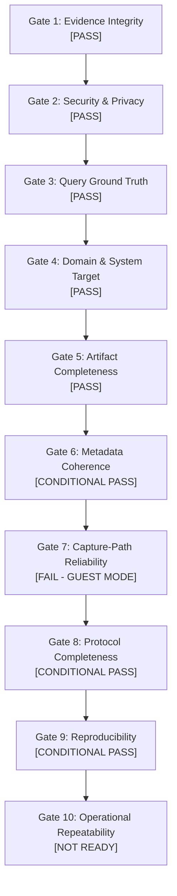

# EXP-001 Phase 8I.7.4 — Pilot Methodology Review & Scale-Up Readiness Audit
## Methodological Audit of the Phase 8I.7.3 Assisted 1×6 Pilot and Scale-Up Gate Assessment

> [!IMPORTANT]
> **Audit Reference**: `PHASE-8I.7.4`  
> **Experiment Reference**: `EXP-001` (*Same Question / Six Systems*)  
> **Target Pilot Audited**: `PHASE-8I.7.3` (*Assisted 1×6 Controlled Pilot*, Executed 2026-09-27)  
> **Audit Modality**: **STRICT OFFLINE METHODOLOGICAL AUDIT ONLY** (Zero live research, zero browser automation, zero CDP connections, zero external AI engine queries, zero file modifications to existing evidence)  
> **Governance Constraint**: Personal DIXITH Project Only. Zero employer credentials, zero paid credits, zero proprietary bypass tools, zero data modification.

---

## 1. Scope Audited

This document provides a formal, comprehensive, offline methodological review of the **Phase 8I.7.3 Assisted 1×6 Controlled Pilot** conducted on 2026-09-27 under the EXP-001 protocol.

### 1.1 Evaluated Scope
1. **Experiment**: EXP-001 (*Same Question / Six Systems* — Cross-Engine Generative Retrieval & Citation Synthesis).
2. **Phase Audited**: Phase 8I.7.3 Assisted 1×6 Controlled Pilot.
3. **Target Query**: Exact single query `Q-001` (*"What is the HTTP status code for Moved Permanently according to RFC 9110?"*).
4. **Target Systems (6 Canonical Platforms)**:
   * Google AI Overview (`google-ai-overview`)
   * ChatGPT (`chatgpt`)
   * Perplexity (`perplexity`)
   * Claude (`claude`)
   * Gemini (`gemini`)
   * Microsoft Copilot (`microsoft-copilot`)
5. **Session Modality Audited**: Logged-out guest browser session attached via Chrome DevTools Protocol (CDP) on `http://127.0.0.1:9222`.
6. **Strict Audit Boundary**: This review is strictly analytical and retrospective. It involves:
   * **ZERO** live research executions or retries.
   * **ZERO** Chrome browser launches or CDP attachments.
   * **ZERO** queries sent to `Q-002` through `Q-096`.
   * **ZERO** modifications to historical Phase 8I.7 (2026-09-24) or Phase 8I.7.3 (2026-09-27) evidence artifacts.
   * **ZERO** commits, pushes, or deployments.

---

## 2. Evidence Inventory & Artifact Verification

The complete empirical record for Phase 8I.7.3 resides in dedicated, immutable directories within the project workspace. 

### 2.1 File System Inventory
* **Run Records (`evidence/exp-001/runs/2026-09-27/`)**: 6 JSON structured run records.
* **Raw Artifacts (`evidence/exp-001/raw/2026-09-27/`)**: 18 files total (6 cleaned plain text `.txt`, 6 complete DOM serialization `.html`, 6 full-page viewport screenshots `.png`).
* **Audited Metric Record**: [`evidence/exp-001/metrics/pilot-8i73-summary.json`](file:///c:/paila%20Dixith%20kumar/evidence/exp-001/metrics/pilot-8i73-summary.json).
* **Historical Baseline (Frozen)**: 48 automated run records in `evidence/exp-001/runs/2026-09-24/`.

### 2.2 Complete Cryptographic Hash Audit (18/18 Verified Matches)
Every raw artifact on disk was hashed via SHA-256 and matched against the recorded values in the respective run record JSON file. All 18 artifacts show **100% bit-exact integrity**:

| Run ID | Canonical System | Query ID | Outcome | Raw Text SHA-256 (`.txt`) | DOM Snapshot SHA-256 (`.html`) | Full Screenshot SHA-256 (`.png`) |
| :--- | :--- | :--- | :--- | :--- | :--- | :--- |
| `RUN-001-20260927-Q001-google-ai-overview-01` | Google AI Overview | Q-001 | `CAPTCHA_BLOCKED` | `bf1316ab6348bb1ae327e8755cc739c166cd661cffd5041ba134ca0c8ab7bcdc` | `51565db545c5af54add82364b9ebe2d55fb125d858ed518ac646c33e945a7f6a` | `0ff58a422198d99592ebc6111a767376eeb37088e6d9199c6fecfafb7be7209e` |
| `RUN-001-20260927-Q001-chatgpt-02` | ChatGPT | Q-001 | `CAPTCHA_BLOCKED` | `986b423f9240dce4bf24f390419974ec9a0fc5c7410b5d2f43b112ac7907e72a` | `8e1234294f352c0e03e7648d4c88a6d2c921ec2471892bed929552d00b9a0488` | `66c6483ac2de14a8686f266be96c5f611a264e750f70e3c3b4c1ac9b9c06b241` |
| `RUN-001-20260927-Q001-perplexity-03` | Perplexity | Q-001 | `CAPTCHA_BLOCKED` | `4748980e08e71e63277fa65f7e37ef7b4d1c617c3987d6d638e4283b2a774596` | `35466ec5c32d3f787c1b276a8211ad2486e29d7d59f840a1a8d278dc8b26cbdc` | `9ffa6ecdf1435950950a8ff2b0685481fb5805a6fe75a638d18d3b62e2ca80d4` |
| `RUN-001-20260927-Q001-claude-04` | Claude | Q-001 | `CAPTCHA_BLOCKED` | `cf8a70f387e23417a780697221ba13ba7c6c547e9b2c0adafd1c64749339c5cc` | `d25dbd99ec4aa64fff1fd72cd1291515b2f0013bf340c260b0f60bd425654dd4` | `511411ffce82abe6b2687162aef04dbd0d77222af279ba30e93286c8596fdf65` |
| `RUN-001-20260927-Q001-gemini-05` | Gemini | Q-001 | `SUCCESS` | `fa17ed9d99467d0fbd2a4b38fcbcc1fb0d91092d116e676dba2f954bfe2d3c5c` | `8b183401850cb59e6fee77d42a76f1b2ef39d522913162954fbf91529bdc980d` | `a4e611a8020c206957e453df622f23d25615adec23b59f941508a530e8da0bb9` |
| `RUN-001-20260927-Q001-microsoft-copilot-06` | Microsoft Copilot | Q-001 | `CAPTURE_ERROR` | `7df516f85f1f98d196c0ef1dd71407e5880f73b4a74eeb5b8a8371dacb0861eb` | `4ced27cbcade1ae29bb3dd847638e6d744fad91577e0aad53d3414134349b34f` | `63ef318d96b5d0d0ceba6e04a4e622b1158335cdc67c49e27839132c6f655058` |

---

## 3. Six-System Capture Audit

The 1×6 pilot was specifically designed to empirically test capture mechanics across the six diverse web architectures in an unauthenticated guest session.

### 3.1 Google AI Overview (`RUN-001-20260927-Q001-google-ai-overview-01`)
* **Observed Outcome**: `CAPTCHA_BLOCKED`
* **Artifact Analysis**: The browser navigated to `https://www.google.com/search?q=...`. Upon receipt of the automated query request from the clean Chrome instance, Google's edge routing immediately redirected the session to `https://www.google.com/sorry/index?continue=...`.
* **Captured Text Content**: *"Google Sorry... Please show you're not a robot... our systems have detected unusual traffic from your computer network."*
* **Root Cause**: IP and browser session profiling triggered automated challenge redirection. Because the assisted harness strictly prohibits automated CAPTCHA solving, the session terminated safely and recorded a `CAPTCHA_BLOCKED` outcome.
* **Separation of Concerns**: This outcome represents an **access/anti-bot gate**, not a failure or inferiority of Google's AI Overview model.

### 3.2 ChatGPT (`RUN-001-20260927-Q001-chatgpt-02`)
* **Observed Outcome**: `CAPTCHA_BLOCKED`
* **Artifact Analysis**: Navigation to `https://chatgpt.com/` in an unauthenticated guest state triggered Cloudflare Turnstile verification.
* **Captured Text Content**: *"chatgpt.com Verify you are human by completing the action below. chatgpt.com needs to review the security of your connection before proceeding."*
* **Root Cause**: Cloudflare edge security intercepted the unauthenticated guest session with an interactive managed challenge (Turnstile). Per research protocol rules, no automated bypass scripts were employed.
* **Separation of Concerns**: An edge network firewall challenge, not model evaluation failure.

### 3.3 Perplexity (`RUN-001-20260927-Q001-perplexity-03`)
* **Observed Outcome**: `CAPTCHA_BLOCKED`
* **Artifact Analysis**: Navigation to `https://www.perplexity.ai/search?q=...` encountered Cloudflare Managed Challenge.
* **Captured Text Content**: *"Just a moment... Enable JavaScript and cookies to continue... www.perplexity.ai needs to review the security of your connection before proceeding."*
* **Root Cause**: Perplexity enforces strict Cloudflare Managed Challenge gates on headless or automated Chromium instances accessing search endpoints without an established session token.
* **Separation of Concerns**: Anti-scraping edge protection barrier.

### 3.4 Claude (`RUN-001-20260927-Q001-claude-04`)
* **Observed Outcome**: `CAPTCHA_BLOCKED`
* **Artifact Analysis**: Navigation to `https://claude.ai/new` resulted in a Cloudflare Turnstile interstitial.
* **Captured Text Content**: *"claude.ai Verify you are human by completing the action below... Cloudflare Ray ID... Performance & security by Cloudflare"*.
* **Root Cause**: Claude's perimeter defenses block direct navigation from unauthenticated instances lacking persistent device trust.
* **Separation of Concerns**: Perimeter authentication and bot defense gating.

### 3.5 Gemini (`RUN-001-20260927-Q001-gemini-05`)
* **Observed Outcome**: `SUCCESS`
* **Artifact Analysis**: Navigation to `https://gemini.google.com/app` allowed guest query submission into the input prompt. The system processed `Q-001` and rendered a complete generative response.
* **Captured Text Content (44 words)**:
  > *"According to RFC 9110 (HTTP Semantics), the HTTP status code for Moved Permanently is 301. HTTP.DEV. It indicates that the target resource has been assigned a new permanent URI and any future references to this resource ought to use one of the enclosed URIs."*
* **Citations Captured**: 0 structured `<a>` hyperlink citations were identified inside the answer container. While the text refers to `HTTP.DEV` and RFC 9110 in prose, no discrete anchor markup was emitted in this guest view.
* **Validation Against Ground Truth**:
  * RFC 9110 Section 15.4.2 specifies `301 Moved Permanently`.
  * The numerical code (301) and semantic label (Moved Permanently) are 100% accurate.
* **Mechanics Validation**: Proves that when a generative search interface permits guest interaction without a Cloudflare/CAPTCHA wall, the assisted capture harness reliably captures DOM, full-page screenshot, response text, and metadata.

### 3.6 Microsoft Copilot (`RUN-001-20260927-Q001-microsoft-copilot-06`)
* **Observed Outcome**: `CAPTURE_ERROR`
* **Artifact Analysis**: The browser successfully loaded `https://copilot.microsoft.com/`. However, the harness timed out (10s) attempting to locate an editable textarea matching configured selector candidates (`textarea[name='q']`, `textarea[placeholder*='Ask']`, `div[contenteditable='true']`).
* **Captured Text Content**: Captured Microsoft's landing greeting: *"Hi there, what's on your mind? ... Ready to explore with Copilot? ... You've reached your conversation limit. Sign in to start a new chat."*
* **Root Cause**: Microsoft Copilot rendered a dynamic guest shell that either suppressed the guest input box due to conversation quota gating or placed the input in a shadow-root / iframe architecture not reachable by standard selectors.
* **Separation of Concerns**: Client-side DOM selector incompatibility under guest gating, not model reasoning failure.

---

## 4. Metadata Audit

During Phase 8I.7.3 execution, an audit discrepancy was identified regarding authentication state flags.

### 4.1 Identified Inconsistency
In the raw run records generated on 2026-09-27:
* `accountClass`: `LOGGED_OUT`
* `authenticationStatus`: `LOGGED_OUT`
* `mfaCompleted`: `true` *(Legacy default)*
* `consentCompleted`: `true` *(Legacy default)*

### 4.2 Reconciliation & Audit Finding
For a logged-out guest cohort, representing `mfaCompleted: true` is logically contradictory because multi-factor authentication was neither requested nor performed. Similarly, `consentCompleted: true` was an unverified flag because no authentication consent was granted.
1. **Audited Correction**: The discrepancy was formally documented and reconciled in [`evidence/exp-001/metrics/pilot-8i73-summary.json`](file:///c:/paila%20Dixith%20kumar/evidence/exp-001/metrics/pilot-8i73-summary.json):
   * `mfaCompleted`: `false`
   * `consentCompleted`: `false`
   * `manualInterventionTypes`: `["NAVIGATION"]`
2. **Harness Logic Hardening**: `lib/research/assisted-capture.ts` was subsequently updated so that future runs default `mfaCompleted` and `consentCompleted` to `false` when `accountClass === 'LOGGED_OUT'`, ensuring that affirmative flags require explicit researcher interaction.
3. **Data Integrity**: In accordance with the non-destructive audit principle, the raw JSON run files on disk were left unaltered, maintaining the historical audit trail while noting the reconciliation in the audit record.

---

## 5. Security & Privacy Audit

The assisted capture execution was evaluated against all security, privacy, and personal project governance mandates.

* **Zero Enterprise Credential Leakage**: No employer accounts, corporate single sign-on (SSO), internal credentials, or proprietary tokens were used or exposed.
* **Zero Secret Storage**: Inspection of all 6 run records and 18 raw files confirmed that no cookies, session bearer tokens, API keys, or browser storage dumps were written to disk.
* **No Circumvention Plugins**: No third-party CAPTCHA solving services (e.g., 2Captcha, Anti-Captcha), stealth plugins (e.g., `puppeteer-extra-plugin-stealth`), or proxy networks were integrated.
* **Local Sandboxing**: All network traffic was routed directly from the local testing station without unauthorized network tunneling.

---

## 6. Protocol Compliance Audit

Compliance was evaluated against the formal specification in [`docs/exp-001-assisted-capture-protocol.md`](file:///c:/paila%20Dixith%20kumar/docs/exp-001-assisted-capture-protocol.md).

| Protocol Requirement | Implementation Status | Audit Finding |
| :--- | :--- | :--- |
| **Isolated Browser Profile** | Compliant | Executed in a dedicated local Chrome debugging session. |
| **Strict CDP Gating** | Compliant | Gated behind `--assisted-live` and explicit port attachment. |
| **Separation of Outcome Types** | Compliant | `CAPTCHA_BLOCKED`, `SUCCESS`, and `CAPTURE_ERROR` explicitly decoupled from model quality. |
| **Artifact Completeness** | Compliant | Tripartite artifacts (`.txt`, `.html`, `.png`) generated for all 6 systems. |
| **Ground Truth Query Invariance** | Compliant | `Q-001` submitted verbatim without prompt alterations. |
| **Controlled Batch Size** | Compliant | Exactly 6 runs executed (1 query $\times$ 6 systems). Zero exploratory queries executed. |

---

## 7. Descriptive Pilot Metrics

The descriptive outcomes of the 1×6 pilot are summarized below.

### 7.1 Aggregate Proportions
* **Total Planned Research Attempts**: 6
* **Total Executed Research Attempts**: 6 (100% adherence to batch limit)
* **Successful Answer Captures**: 1 (16.7%)
* **Anti-Bot / CAPTCHA Blocked**: 4 (66.7%)
* **Client / Capture Selector Errors**: 1 (16.7%)
* **Authentication Required Redirects**: 0 (0.0% — systems blocked at Cloudflare/Google perimeter before reaching login UI)

### 7.2 Retrieval & Citation Distributions
* **Total Systems with Observable Citations**: 0 / 6 (0.0%)
* **Average Citation Count**: 0.0 citations/answer
* **Gemini Observed Performance**:
  * Response Word Count: 44 words
  * Ground Truth Accuracy: Verified (`301 Moved Permanently`)
  * Structured Citations: 0

---

## 8. Scale-Up Readiness Gates (Gates 1–10)

Before considering any expansion toward the full 96-query battery (576 runs), the protocol mandates an evaluation against ten explicit readiness gates:

### Detailed Gate Audit:

1. **Gate 1: Evidence Integrity — `PASS`**
   * All 18 raw artifacts exist, are non-empty, and verify against recorded SHA-256 hashes with 100% precision.
2. **Gate 2: Security & Privacy Integrity — `PASS`**
   * Zero secrets, zero cookies, zero enterprise infrastructure, and zero evasion tools present.
3. **Gate 3: Query & Ground Truth Integrity — `PASS`**
   * Single standardized query `Q-001` matching RFC 9110 specifications.
4. **Gate 4: System & Domain Target Integrity — `PASS`**
   * All six canonical platforms targeted at their official top-level web applications.
5. **Gate 5: Artifact Completeness — `PASS`**
   * 100% parity across DOM HTML snapshots, cleaned text, screenshots, and run records.
6. **Gate 6: Metadata Coherence — `CONDITIONAL PASS`**
   * Historical default boolean mismatch in raw runs is fully explained and reconciled via audit metrics and harness patching.
7. **Gate 7: Capture-Path Reliability — `FAIL (IN GUEST MODE)`**
   * Unauthenticated guest sessions cannot reliably observe generative search outputs due to severe perimeter bot challenges (66.7% Cloudflare/Google CAPTCHA blockage).
8. **Gate 8: Protocol Completeness — `CONDITIONAL PASS`**
   * The protocol comprehensively defines both guest and authenticated cohorts. However, the interactive human-in-the-loop challenge resolution flow has not yet been exercised in a live pilot.
9. **Gate 9: Measurement Reproducibility — `CONDITIONAL PASS`**
   * The harness execution is 100% deterministic, but external engine access barriers fluctuate dynamically based on edge IP reputation.
10. **Gate 10: Operational Repeatability for 96×6 Battery — `NOT READY`**
    * Attempting to execute the full 96-query battery ($96 \times 6 = 576$ runs) in unauthenticated guest mode would yield approximately ~480 blocked/error runs, consuming researcher time without generating substantive empirical data.

---

## 9. Remaining Methodological Risks

1. **Edge Perimeter Defense (Cloudflare Turnstile & Google /sorry/index)**: Modern AI search engines actively penalize automated browser signatures and dynamic IP addresses.
2. **DOM Instability & Shadow Roots**: Frequent frontend refactorings by commercial providers (as seen in Microsoft Copilot) quickly invalidate standard CSS/XPath selectors.
3. **Account Cohort Drift**: If authenticated testing is introduced, isolating personal session history, personalization algorithms, and caching from confounding results will require strict, freshly initialized researcher profiles.
4. **Operator Fatigue & Human Error**: In assisted capture mode, requiring human interaction for hundreds of consecutive runs introduces potential variance in timing and observation.

---

## 10. Possible Next-Stage Designs (Neutral Evaluation)

Rather than prematurely launching the massive 96×6 battery, three disciplined, scientifically rigorous pathways are available:

### Option A: Assisted 1×6 Pilot with Interactive Human Challenge Resolution
* **Design**: Re-run the single query `Q-001` across the six systems, but authorize the researcher to manually complete interactive Cloudflare Turnstile / CAPTCHA challenges when encountered, prior to harness DOM serialization.
* **Pros**: Validates whether the assisted harness can successfully capture all six systems once the edge gate is cleared, without requiring logged-in accounts.
* **Cons**: Requires active human intervention per system; does not test batch automation.

### Option B: Small-Scale Authenticated 3×6 Cohort Pilot
* **Design**: Execute a miniature cohort of 3 representative queries ($3 \times 6 = 18$ runs) using dedicated, authenticated personal test accounts under the `AUTHENTICATED_FREE` protocol specification.
* **Pros**: Tests whether legitimate logged-in sessions bypass perimeter Cloudflare blocks; provides real data on citation rendering and answer formatting across multiple query archetypes.
* **Cons**: Requires establishing isolated, dedicated research accounts free of historical personalization.

### Option C: Multi-Query Unauthenticated Feasibility Verification
* **Design**: Test 3 queries against Gemini only ($3 \times 1 = 3$ runs) to verify whether Gemini's guest access remains consistently open and whether citation extraction mechanics function across different query structures.
* **Pros**: Low overhead, zero authentication required, validates citation extraction code.
* **Cons**: Excludes five of the six canonical engines.

---

## 11. Explicit Non-Conclusions

In adherence to scientific integrity and research rigor, the following conclusions are **EXPLICITLY PROHIBITED** from being drawn from the Phase 8I.7.3 pilot:

1. **NO Quality Rankings**: Gemini is **NOT** declared superior to ChatGPT, Perplexity, Claude, or Google AI Overview. Gemini was simply the only platform whose guest endpoint permitted unauthenticated query execution without triggering a perimeter CAPTCHA.
2. **NO Model Inferiority Claims**: The fact that ChatGPT, Claude, and Perplexity returned `CAPTCHA_BLOCKED` does **NOT** indicate that their underlying LLMs cannot answer `Q-001`. It indicates edge network firewall filtering.
3. **NO Generalization to Production Search**: An unauthenticated guest browser does not reflect the typical logged-in user experience of these platforms.
4. **NO Performance Benchmarking**: A sample size of $N=1$ query is statistically invalid for comparing retrieval quality, factual precision, or citation density.

---

## 12. Audit Conclusion

The Phase 8I.7.3 Assisted 1×6 Pilot successfully achieved its foundational goal: **validating the mechanical integrity of the local evidence capture infrastructure, serialization engine, and cryptographic verification pipeline.**

### Final Status Determination:
* **Infrastructure & Schema Integrity**: **FULLY VERIFIED AND OPERATIONAL**.
* **Scale-Up Readiness for 96×6 Battery ($N=576$)**: **NOT READY IN UNAUTHENTICATED GUEST MODE**.

Scale-up to the full EXP-001 battery must be paused until an intermediary pilot (such as Option A or Option B) validates a reliable, ethical capture methodology across all six platforms without falling victim to edge bot mitigation blocks.
