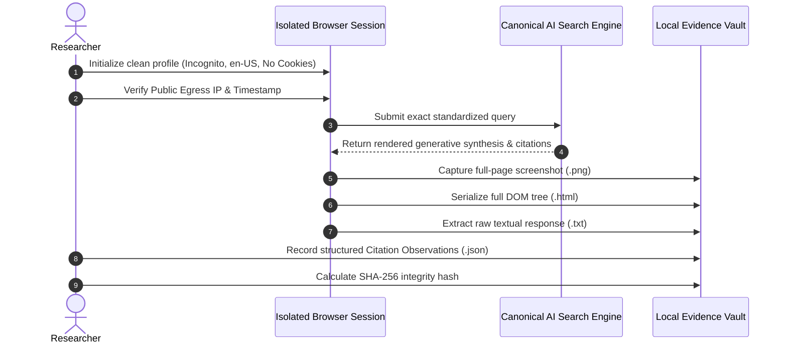

# DIXITH Research Protocol Specification: EXP-001
## Cross-Engine Generative Retrieval & Citation Synthesis Protocol (Six Systems, One Question)

> [!IMPORTANT]
> **Protocol Status**: **STANDARDIZED PROTOCOL SPECIFICATION (PRE-EXECUTION)**  
> **Experiment Status**: `ACTIVE` (Laboratory Specification & Test Framework)  
> **Associated Research Records**: `EXP-012` (`IN_REVIEW`), `EXP-013` (`IN_REVIEW`), `EXP-014` (`IN_REVIEW`)  
> **Data Fabrication Policy**: Strict Zero-Tolerance. No synthetic responses, simulated citations, or hypothetical engine metrics are included in this document or the DIXITH corpus. All empirical fields will remain unpopulated until formal controlled execution begins.  
> **Resource Governance**: Personal research project only. Strictly zero company Claude accounts, employer API keys, employer cloud infrastructure, employer GitHub resources, or paid external AI services.

---

## 1. Objective

The primary objective of **EXP-001** (*Same Question / Six Systems*) is to establish a rigorous, repeatable, and transparent experimental protocol to measure how modern generative search and AI answer engines retrieve, synthesize, cite, and attribute third-party digital information when prompted with identical informational, technical, commercial, and entity-focused queries.

Generative AI search represents a fundamental paradigm shift from classical list-based Information Retrieval (IR) to synthesized generation (Generative Engine Optimization — GEO / Answer Engine Optimization — AEO). However, empirical methodologies for evaluating these engines frequently suffer from:
1. Conflating different engine classes (search-native RAG vs. parametric reasoning models).
2. Failing to isolate geographic, personalization, and session biases.
3. Ignoring engine-specific user interface (UI) citation mechanics.
4. Conflating researcher interpretations with direct empirical observations.

EXP-001 provides an open, scientific standard to record, evaluate, and benchmark cross-engine behavior over time without vendor bias.

---

## 2. Research Questions

### Primary Research Question
> **How do identical informational and entity queries diverge in citation density, domain authority distribution, entity alignment, and answer structure across the six major AI search platforms?**

### Secondary Sub-Questions
1. **Citation Association**: How reliably do citations link directly to specific factual claims versus serving as loose, paragraph-level or global references?
2. **Domain Diversity & Overlap**: To what degree do search-native systems and parametric LLM systems cite the same root domains for identical queries?
3. **Structured Data Sensitivity**: Does the presence of verified Schema.org entity graphs on a source domain correlate with higher citation selection frequency?
4. **Temporal Stability**: How stable are citations and response structures when identical queries are re-executed across consecutive days or weeks under identical session conditions?

---

## 3. Systems Under Test (Six Canonical Platforms)

Testing is strictly restricted to the **six canonical AI search systems**. No secondary or unverified experimental search engines may be introduced.

| Canonical System | Architecture Type | Primary Retrieval Pipeline | Primary Citation UI Mechanism |
| :--- | :--- | :--- | :--- |
| **1. Google AI Overview** | Search-Native RAG | Google Search Web Index + Gemini Parametric Synthesis | Inline link pills, right-hand source carousels, expandable card accordions |
| **2. ChatGPT (Search)** | Conversational LLM + Web RAG | Bing / Web Index + OpenAI Parametric Models | Inline bracketed citations `[1]`, hover popovers, bottom source list |
| **3. Perplexity** | Native Hybrid Answer Engine | Multi-Index Web Retrieval + Fine-tuned LLM Synthesizer | Superscript numbers `[1]`, top source favicon cards, direct domain attribution |
| **4. Claude (Web Search)** | Constitutional Reasoning LLM | Third-Party Web Indexing API + Anthropic Claude | Inline numbered citations, collapsed source drawers, explicit quotation blocks |
| **5. Gemini** | Multimodal Parametric Engine | Google Web Index + Deep Google Knowledge Graph | "Double-check" search buttons, inline source highlight tooltips, footer links |
| **6. Microsoft Copilot** | Enterprise & Consumer RAG | Bing Search Index + OpenAI / Microsoft Synthesis | Numbered citation pills, hover summary boxes, edge sidebar source cards |

> [!CAUTION]
> **Prohibited Systems**: Unverified, deprecated, or non-canonical AI search engines (specifically `You.com`, `SearchGPT` as a standalone entity, `Phind`, and `Genspark`) are **strictly prohibited** from the test matrix to maintain methodological integrity and longitudinal comparability.

---

## 4. Query Battery Design

Queries must not be improvised or selected ad-hoc. The experimental battery comprises six discrete query categories designed to test different layers of the retrieval-augmented generation pipeline.

```
                              ┌─────────────────────────────────────────┐
                              │     EXP-001 Query Battery Taxonomy      │
                              └────────────────────┬────────────────────┘
                                                   │
         ┌──────────────────┬──────────────────────┼──────────────────────┬──────────────────┐
         │                  │                      │                      │                  │
         ▼                  ▼                      ▼                      ▼                  ▼
   ┌───────────┐      ┌────────────┐        ┌─────────────┐        ┌────────────┐     ┌─────────────┐
   │  FACTUAL  │      │EXPLANATORY │        │ COMPARISON  │        │   ENTITY   │     │  TECHNICAL  │
   │  QUERIES  │      │  QUERIES   │        │   QUERIES   │        │  QUERIES   │     │   QUERIES   │
   └───────────┘      └────────────┘        └─────────────┘        └────────────┘     └─────────────┘
         │
         ▼
   ┌────────────────────┐
   │CURRENT INFORMATION│
   │      QUERIES       │
   └────────────────────┘
```

### 4.1. Factual Queries (`FACTUAL`)
* **Purpose**: Evaluate retrieval accuracy, direct answer extraction, and primary source citation for unambiguous, objective facts.
* **Inclusion Criteria**: Queries with verifiable, non-controversial ground truth answers (e.g. standards specifications, mathematical constants, established protocols).
* **Exclusion Criteria**: Subjective opinions, lifestyle advice, speculative topics, ambiguous wording.
* **Recommended Battery Size**: 15–20 standardized queries per cohort.

### 4.2. Explanatory Queries (`EXPLANATORY`)
* **Purpose**: Test multi-source synthesis depth, conceptual decomposition, and how engines structure long-form narrative explanations.
* **Inclusion Criteria**: "How does X work?", "Why does X occur?", requiring multi-paragraph conceptual synthesis across computer science, information theory, or technical SEO.
* **Exclusion Criteria**: Queries that can be answered in a single sentence or bullet point.
* **Recommended Battery Size**: 15–20 standardized queries per cohort.

### 4.3. Comparison Queries (`COMPARISON`)
* **Purpose**: Measure neutrality, multi-perspective retrieval, balanced source citation, and structured tabular presentation.
* **Inclusion Criteria**: Direct A vs. B comparative queries (e.g. "Server-Side Rendering vs. Static Site Generation for search engine crawlers").
* **Exclusion Criteria**: Biased or leading prompts (e.g. "Why is X better than Y?").
* **Recommended Battery Size**: 10–15 standardized queries per cohort.

### 4.4. Entity Queries (`ENTITY`)
* **Purpose**: Measure entity disambiguation, Knowledge Graph integration, and sensitivity to structured Schema.org markup.
* **Inclusion Criteria**: Named individuals, technical organizations, specific software products, or clinical entities with potential ambiguity.
* **Exclusion Criteria**: Generic non-entity vocabulary terms.
* **Recommended Battery Size**: 15–20 standardized queries per cohort.

### 4.5. Technical Implementation Queries (`TECHNICAL`)
* **Purpose**: Evaluate code extraction accuracy, syntax highlighting, API documentation citation, and handling of technical constraints.
* **Inclusion Criteria**: Queries requesting precise implementation code snippets, robots.txt directives, JSON-LD schemas, or HTTP header configurations.
* **Exclusion Criteria**: Pseudo-code requests, high-level non-technical advice.
* **Recommended Battery Size**: 15–20 standardized queries per cohort.

### 4.6. Current Information Queries (`CURRENT_INFORMATION`)
* **Purpose**: Test index freshness, crawl velocity, real-time RAG latency, and citation of fast-breaking technical announcements.
* **Inclusion Criteria**: Queries regarding search engine algorithm updates, recent standard revisions, or software version releases occurring within the prior 30 days.
* **Exclusion Criteria**: Historic events with stable long-term consensus.
* **Recommended Battery Size**: 10–15 standardized queries per cohort.

> [!NOTE]
> *Sample Size Justification*: A complete experimental round consists of **80 to 110 queries** across the six categories. Claims of statistical significance will be avoided unless supported by adequate repetition runs ($N \ge 30$ per query condition).

---

## 5. Experimental Controls & Variable Governance

Generative AI search engines operate within dynamic distributed environments. The protocol classifies all experimental variables by their practical degree of control.

| Variable | Target Experimental State | Control Level | Methodological Handling |
| :--- | :--- | :---: | :--- |
| **Exact Query String** | Identical character-for-character query submitted across all engines | **CONTROLLED** | Strictly verified via automated clipboard/script injection |
| **Prompt Wrapper** | Raw search interface submission (no custom system instructions or persona prompts) | **CONTROLLED** | Executed in vanilla search entrypoints without preamble |
| **Language & Locale** | `en-US` / `en-GB` standardized browser headers | **CONTROLLED** | Enforced via browser profile locale and HTTP headers |
| **Execution Window** | Near-simultaneous submission ($\le 5$ minutes across all 6 engines) | **CONTROLLED** | Parallel orchestration to minimize web index drift |
| **Personalization State** | Clean, logged-out incognito session profile; fresh cookies and local storage | **PARTIALLY_CONTROLLED** | Browser fingerprinting or persistent account requirements may introduce subtle bias |
| **Geographic Context** | Fixed residential or cloud egress IP node | **PARTIALLY_CONTROLLED** | Geo-routing varies by CDN; must record exact public egress IP and geo-coordinates |
| **Search Mode / Feature Toggle** | Default web search mode enabled | **PARTIALLY_CONTROLLED** | Logged as observed (e.g. "Default", "Deep Search", "Browse with Bing") |
| **Engine Model Snapshot** | Specific underlying foundation model version | **NOT FULLY CONTROLLABLE** | Search providers update model weights silently without version tags |
| **Crawl Index State** | Document freshness in engine's underlying web index | **NOT FULLY CONTROLLABLE** | Asynchronous crawl caches cannot be externally inspected |
| **Non-Deterministic Decoding** | Temperature, top-$p$, and sampling seed in proprietary engine APIs | **NOT FULLY CONTROLLABLE** | Addressed exclusively through multi-run repetitions |
| **A/B User Interface Testing** | Variant layout of citation pills, cards, and carousels | **NOT FULLY CONTROLLABLE** | Capture raw DOM and screenshot to record exact UI variant |

---

## 6. Execution & Run Protocol

Each benchmark execution must follow a strict, immutable sequence:



### Step-by-Step Execution Rules
1. **Session Isolation**: A new, clean browser context (or automated Playwright profile) must be instantiated for each query battery run. No historical search cookies or cached session tokens may persist.
2. **Pre-Flight Recording**: Record UTC timestamp, client timezone, public egress IP, and user-agent string.
3. **Query Submission**: The exact query string is entered without trailing spaces or typos.
4. **Completion Wait**: Allow the engine's streaming synthesis and citation cards to completely finish rendering (wait for network idle $\ge 5$ seconds after last DOM mutation).
5. **Raw Artifact Capture**:
   - Save the raw text of the synthesis.
   - Save the complete serialized DOM.
   - Capture a full-page scroll screenshot preserving all citation popups or cards.
6. **Integrity Hashing**: Compute the cryptographic SHA-256 hash of the raw response payload to guarantee tamper evidence.

---

## 7. Citation Capture Protocol

Citations must be captured with complete granularity. Because different engines display citations through disparate UI paradigms, the protocol defines an exhaustive citation observation model.

### 7.1. Citation Observation Attributes
For every citation identified in an engine response, record:
- **`citedTitle`**: The human-readable title displayed in the citation pill, card, or tooltip.
- **`citedUrl`**: The clean destination URL (resolving redirect wrappers like `google.com/url?...` or `bing.com/ck/...` to the true canonical target).
- **`sourceDomain`**: The fully qualified root domain (e.g. `developer.mozilla.org`, `schema.org`).
- **`positionIndex`**: 1-based sequential order of appearance in the text or citation list.
- **`renderFormat`**: The UI rendering mechanism:
  - `INLINE_BRACKETED_NUMBER` (e.g. `[1]`)
  - `INLINE_FAVICON_PILL`
  - `HOVER_POPUP_CARD`
  - `SIDEBAR_SOURCE_LIST`
  - `BOTTOM_FOOTNOTE_LINKS`
  - `CAROUSEL_CARD`
  - `NOT_OBSERVABLE`
- **`associationState`**: How closely the citation binds to a specific factual proposition:
  - `DIRECT_CLAIM_ANCHOR`: Placed immediately adjacent to a specific sentence or numerical claim.
  - `PARAGRAPH_LEVEL_REFERENCE`: Placed at the end of a section summarizing multiple facts.
  - `FOOTNOTE_GLOBAL_REFERENCE`: Listed in a general bibliography at the bottom.
  - `CAROUSEL_CARD_UNLINKED`: Appears in a source carousel without explicit in-text reference.
  - `NOT_OBSERVABLE`
- **`associatedClaimSnippet`**: The exact sentence or clause directly adjacent to the citation anchor.
- **`sourceClassification`**:
  - `OFFICIAL_DOCUMENTATION`
  - `ACADEMIC_PEER_REVIEWED`
  - `STANDARDS_SPECIFICATION`
  - `JOURNALISTIC_NEWS`
  - `INDUSTRY_PORTAL_OR_BLOG`
  - `COMMERCIAL_VENDOR`
  - `COMMUNITY_FORUM`
  - `NOT_OBSERVABLE`

---

## 8. Observation vs. Measurement vs. Finding vs. Interpretation

To preserve scientific rigor, all analytical statements must be categorized into one of five strictly separated conceptual tiers:

```
┌────────────────────────────────────────────────────────────────────────┐
│                        EPISTEMOLOGICAL HIERARCHY                       │
├───────────────────┬────────────────────────────────────────────────────┤
│ 1. OBSERVATION    │ Direct sensory fact seen in captured output        │
├───────────────────┼────────────────────────────────────────────────────┤
│ 2. MEASUREMENT    │ Derived mathematical or quantitative value         │
├───────────────────┼────────────────────────────────────────────────────┤
│ 3. FINDING        │ Evidentiary conclusion supported by measurements   │
├───────────────────┼────────────────────────────────────────────────────┤
│ 4. INTERPRETATION │ Contextual reasoning or hypothesis by researcher   │
├───────────────────┼────────────────────────────────────────────────────┤
│ 5. LIMITATION     │ Explicit boundary restricting generalizability    │
└───────────────────┴────────────────────────────────────────────────────┘
```

### Definitions & Examples

1. **OBSERVATION** (Directly seen in output):
   - *Definition*: A verifiable statement of what was explicitly present in the captured payload.
   - *Example*: *"System A cited 3 unique URLs in response to query QRY-004, rendering them as bracketed numbers at the conclusion of paragraphs 1, 2, and 4."*
2. **MEASUREMENT** (Derived mathematical value):
   - *Definition*: A quantitative metric calculated deterministically from raw observations across a defined sample.
   - *Example*: *"The mean citation density for Category EXPLANATORY in System A is 2.4 citations per 100 words ($SD = 0.6, N = 20$)."*
3. **FINDING** (Evidentiary conclusion):
   - *Definition*: A conclusion directly supported by verified measurements and observations that answers a research question.
   - *Example*: *"System A exhibited higher citation density on technical documentation queries than on broad explanatory queries across Cohort 1."*
4. **INTERPRETATION** (Researcher's analysis):
   - *Definition*: A reasoned explanation or theory regarding why an observed pattern occurred.
   - *Example*: *"This pattern suggests that System A's retrieval pipeline applies higher query-intent thresholds before triggering web retrieval for broad explanatory topics."*
5. **LIMITATION** (Boundary condition):
   - *Definition*: An acknowledged technical or environmental factor that restricts the validity or generalizability of the finding.
   - *Example*: *"Because System A does not expose its underlying model weights or search index version, findings are limited to the specific client IP and execution date."*

> [!CAUTION]
> **Boundary Rule**: Never present an *Interpretation* as a *Finding*. Never present a single unverified *Observation* as a generalized *Measurement*.

---

## 9. Derived Measurement Metrics

When sufficient runs are collected, the following standardized metrics may be derived:

1. **Citation Density ($D_{cite}$)**:
   $$\text{Citation Density} = \frac{\text{Total Observed Citations}}{\text{Total Response Word Count}} \times 100$$
2. **Domain Overlap Coefficient ($S_{overlap}$)**:
   $$\text{Overlap}(A, B) = \frac{|D_A \cap D_B|}{|D_A \cup D_B|}$$
   where $D_A$ and $D_B$ are the sets of unique domains cited by System $A$ and System $B$ for identical queries.
3. **Primary Authority Ratio ($R_{auth}$)**:
   $$R_{auth} = \frac{\text{Citations to Official Specs, Docs, or Peer-Reviewed Sources}}{\text{Total Citations}}$$
4. **Claim-Binding Ratio ($R_{claim}$)**:
   $$R_{claim} = \frac{\text{Citations with DIRECT\_CLAIM\_ANCHOR}}{\text{Total Citations}}$$

---

## 10. Repeatability & Longitudinal Protocol

AI search engines are stochastic and subject to ongoing web index updates. Repeatability must be evaluated systematically:

1. **Repetition Cadence**:
   - **Intra-Day Repetition**: 3 runs spaced 2 hours apart to evaluate decoding non-determinism.
   - **Inter-Day Repetition**: Runs executed at $T+1\text{ day}$, $T+7\text{ days}$, and $T+30\text{ days}$ to evaluate index freshness and temporal stability.
2. **Response Differentiation Tracking**:
   - Compare response text using Normalized Levenshtein Distance and semantic cosine similarity.
   - Track **Citation Churn**: Proportion of cited domains that change between Run 1 and Run $N$.
3. **Stability Scoring**:
   - A query response is classified as *STABLE* if $\ge 80\%$ of cited domains and core claims remain constant across 3 consecutive runs.
   - A query response is classified as *VOLATILE* if cited domains fluctuate by $> 50\%$ within a 7-day period.

---

## 11. Lightweight Local Evidence Storage Architecture

To preserve confidentiality, eliminate dependencies on third-party cloud infrastructure, and avoid recurring database costs, evidence is stored in a clean, local file-based repository structure.

```
evidence/
└── exp-001/
    ├── registry/
    │   ├── queries.json              # Canonical query definitions (QueryDefinition[])
    │   └── systems.json              # Canonical system specifications
    ├── runs/
    │   └── YYYY-MM-DD/
    │       ├── RUN-001-google.json   # Structured ExperimentRunRecord
    │       ├── RUN-001-chatgpt.json
    │       ├── RUN-001-perplexity.json
    │       ├── RUN-001-claude.json
    │       ├── RUN-001-gemini.json
    │       └── RUN-001-copilot.json
    ├── raw/
    │   └── YYYY-MM-DD/
    │       ├── RUN-001-google.txt    # Verbatim text synthesis
    │       ├── RUN-001-google.html   # Serialized DOM snapshot
    │       └── RUN-001-google.png    # Full-page screenshot capture
    └── metrics/
        └── cohort-summary.json       # Derived ExperimentMeasurement[]
```

* Zero external databases (no Supabase, PostgreSQL, or DynamoDB).
* Zero vector databases.
* Complete local reproducibility using standard Node.js/TypeScript tooling.

---

## 12. Privacy, Safety & Ethical Research Safeguards

The EXP-001 protocol enforces strict privacy and ethical boundaries:

1. **No Personal or Client Data**: Queries must be drawn exclusively from public technical concepts, open standards, and synthetic industry scenarios. No real client URLs, private customer data, or employer-confidential materials may ever be submitted.
2. **No Credential Exposure**: No API tokens, passwords, private keys, or internal enterprise credentials may be stored or transmitted in query vectors.
3. **No Terms-of-Service Abuse**: Automated querying must respect search platform rate limits, terms of use, and avoid high-frequency scraping attacks. Manual capture is used when automation is ambiguous or restricted.
4. **Independent Personal Research**: All protocol design and execution is strictly personal research conducted by Dixith Kumar. Zero employer resources or commercial cloud accounts are utilized.

---

## 13. Limitations & Validity Boundaries

All researchers citing or utilizing EXP-001 must acknowledge the following inherent methodological limitations:

1. **Black-Box Opacity**: Search providers do not disclose real-time retrieval parameters, temperature settings, index partition boundaries, or active A/B test cohorts.
2. **Geographic & Network Routing Drift**: Even with fixed egress IP nodes, any CDN or cloud provider may route queries to distinct regional inference clusters.
3. **Citation Ephemerality**: URLs cited during an experimental run may experience link rot, paywall shifts, or domain parking over time.
4. **UI Dynamic Rendering**: Client-side JavaScript changes in engine web interfaces can temporarily disrupt automated DOM parsing of citation cards.
5. **Non-Generalizability of Single Runs**: A single query run provides an *observation*, not a universal truth. Findings are valid only within the context of the documented run battery.

---

## 14. Publication Gate Requirements

For `EXP-001` or its validating research papers (`EXP-012`, `EXP-013`, `EXP-014`) to transition to `PUBLISHED` status, the following objective criteria must be completely satisfied:

- [ ] **Battery Completion**: Minimum of 60 standardized queries executed across all six canonical systems ($N = 360$ raw runs).
- [ ] **Cryptographic Verification**: Every run record has a verified SHA-256 hash matching local raw artifacts.
- [ ] **Zero Synthetic Records**: Every citation and observation links directly to a verifiable physical artifact.
- [ ] **Multi-Run Repetition**: Minimum of 3 longitudinal repetition cycles executed to measure stability.
- [ ] **Statistical Integrity**: All claims of correlation or significance include sample sizes, standard deviations, and explicit limitations.
- [ ] **Peer & Editorial Review**: Methodological review completed and approved before public indexing.

---

*Authored by: Dixith Kumar*  
*Framework: DIXITH AI Search Lab (Personal Research Project)*  
*Specification Reference: `docs/exp-001-research-protocol.md`*
