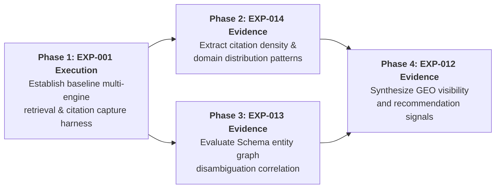

# DIXITH Research Corpus & Experiment Readiness Audit
**Document ID**: `DOC-RES-READY-001`  
**Phase**: `Phase 8I.3 — Research Corpus & Experiment Readiness Audit`  
**Date**: `2026-03-24` / `2026-09-25`  
**Status**: `READ-ONLY AUDIT REPORT`  
**Auditor**: Antigravity Autonomous Research & Architecture Agent  
**Grounding**: Strictly grounded in existing repository code (`data/research.ts`, `data/experiments.ts`, `data/types.ts`, `lib/semantic/types.ts`, `app/research/`, `app/ai-search-lab/`).  
**Certification**: Zero empirical findings have been fabricated; zero external experiments were executed; zero content records have been modified or upgraded to `PUBLISHED`.

---

## 1. Research Corpus Overview

The DIXITH platform defines a specialized research and laboratory subsystem designed to evaluate and document how modern generative AI engines cite, ground, and synthesize technical web content.

Currently, the research corpus in the repository consists of four distinct records:
- **3 Research Protocol Entities** defined in `data/research.ts` (`EXP-012`, `EXP-013`, `EXP-014`), all currently in **`IN_REVIEW`** status.
- **1 Active Laboratory Experiment** defined in `data/experiments.ts` (`EXP-001`), currently in **`ACTIVE`** status.

### Current Inventory & Indexability Summary

| Entity ID | Slug | Title | Category | Current Status | Indexable (`isIndexable`) | Evidence State |
| :--- | :--- | :--- | :--- | :--- | :--- | :--- |
| `EXP-012` | `testing-generative-engine-visibility` | Testing Generative Engine Visibility | GEO | `IN_REVIEW` | `false` (noindex) | Protocol Only / No Raw Data |
| `EXP-013` | `how-entities-influence-ai-search-visibility` | How Entities Influence AI Search Visibility | ENTITY SEARCH | `IN_REVIEW` | `false` (noindex) | Protocol Only / No Raw Data |
| `EXP-014` | `citation-patterns-across-ai-search-systems` | Citation Patterns Across AI Search Systems | AI SEARCH | `IN_REVIEW` | `false` (noindex) | Protocol Only / No Raw Data |
| `EXP-001` | `same-question-six-systems` | SAME QUESTION / SIX SYSTEMS | CROSS-ENGINE RETRIEVAL BENCHMARK | `ACTIVE` | `false` (noindex) | Protocol & Observations / No Raw Captures |

### Overall Readiness Assessment
None of the existing research records in the repository currently contain the empirical datasets, verbatim prompt responses, verified citation position logs, or statistical distribution matrices necessary to justify publication. They currently function as **rigorous research proposals and protocol architectures**. Upgrading any of these records to `PUBLISHED` prior to executing structured query matrices and capturing verifiable evidence would compromise platform integrity and violate academic and technical standards.

---

## 2. Research Record Audit: EXP-012

**Title**: *Testing Generative Engine Visibility*  
**Category**: Generative Engine Optimization (`GEO`)  
**Status**: `IN_REVIEW`  
**Read Time**: `14 min`  

### Field-by-Field Completeness Audit

| Field | Definition in `data/research.ts` | Completeness Status | Notes & Gaps |
| :--- | :--- | :--- | :--- |
| **ID** | `"EXP-012"` | **Complete** | Valid canonical ID. |
| **Title** | `"Testing Generative Engine Visibility"` | **Complete** | Clear descriptive title. |
| **Status** | `"IN_REVIEW"` | **Complete** | Correctly held in review; non-indexable. |
| **Research Question** | *"What architectural signals differentiate direct generative recommendations from passive link indexation?"* | **Complete** | Clearly defined, testable inquiry. |
| **Hypothesis** | `undefined` | **Missing** | No formal null or alternative hypothesis declared in data schema. |
| **Methodology** | *"Systematic brand and concept inclusion tracking across conversational search engines using reproducible test prompts."* | **Partially Complete** | High-level summary only; missing specific prompt scripts, execution schedule, and scoring metrics. |
| **Variables** | `undefined` | **Missing** | Independent, dependent, and controlled variables are not formalized. |
| **Systems Tested** | 6 Canonical Systems (`Google AI Overview`, `ChatGPT`, `Perplexity`, `Claude`, `Gemini`, `Microsoft Copilot`) | **Complete** | Exactly matches the canonical 6-engine standard. |
| **Queries / Prompts** | `undefined` | **Missing** | Zero specific prompt strings or query vector lists stored in record. |
| **Evidence Fields** | `undefined` | **Missing** | Zero raw capture logs, response payloads, or ranking tables. |
| **Observations** | `undefined` | **Missing** | Field is undefined; UI displays a placeholder status notice. |
| **Findings** | `undefined` | **Missing** | No empirical findings exist. |
| **Limitations** | Declares 2 items: LLM non-determinism, model update volatility. | **Complete** | Acknowledges core algorithmic constraints. |
| **Sources** | `sourceIds: ["SRC-001", "SRC-002"]` | **Complete** | Linked to Schema.org and Google Search Central docs. |
| **Topics** | `["TOP-001", "TOP-004"]` | **Complete** | Maps to AI Search Architecture and GEO. |
| **Relationships** | Links to `EXP-001` (`validates`), `EXP-014` (`references`). | **Complete** | Valid relational graph edges. |

---

## 3. Research Record Audit: EXP-013

**Title**: *How Entities Influence AI Search Visibility*  
**Category**: Entity Search & Knowledge Graphs (`ENTITY SEARCH`)  
**Status**: `IN_REVIEW`  
**Read Time**: `9 min`  

### Field-by-Field Completeness Audit

| Field | Definition in `data/research.ts` | Completeness Status | Notes & Gaps |
| :--- | :--- | :--- | :--- |
| **ID** | `"EXP-013"` | **Complete** | Valid canonical ID. |
| **Title** | `"How Entities Influence AI Search Visibility"` | **Complete** | Clear descriptive title. |
| **Status** | `"IN_REVIEW"` | **Complete** | Correctly held in review; non-indexable. |
| **Research Question** | *"To what degree does unambiguous Schema entity markup correlate with accurate entity representation in generative LLM responses?"* | **Complete** | High-value, specific technical SEO question. |
| **Hypothesis** | `undefined` | **Missing** | No formal hypothesis declared. |
| **Methodology** | *"Knowledge graph reconciliation and entity disambiguation tests across corporate and personal web properties."* | **Partially Complete** | Conceptual approach defined; lacks exact test domains, JSON-LD test variations, and parsing validation rules. |
| **Variables** | `undefined` | **Missing** | Missing explicit independent/dependent variable schema. |
| **Systems Tested** | 6 Canonical Systems (`Google AI Overview`, `ChatGPT`, `Perplexity`, `Claude`, `Gemini`, `Microsoft Copilot`) | **Complete** | Exactly matches the canonical 6-engine standard. |
| **Queries / Prompts** | `undefined` | **Missing** | No entity prompt vectors defined in repository. |
| **Evidence Fields** | `undefined` | **Missing** | No entity disambiguation scorecards or citation logs. |
| **Observations** | `undefined` | **Missing** | Undefined; UI falls back to standard in-review message. |
| **Findings** | `undefined` | **Missing** | No empirical findings exist. |
| **Limitations** | Declares 2 items: Knowledge graph ingest latency (24h to weeks), third-party co-occurrence confounding. | **Complete** | Accurately describes real-world knowledge graph latency. |
| **Sources** | `sourceIds: ["SRC-001", "SRC-002"]` | **Complete** | Linked to canonical sources. |
| **Topics** | `["TOP-001", "TOP-006"]` | **Complete** | Maps to AI Search Architecture and Knowledge Graphs. |
| **Relationships** | Links to `EXP-001` (`validates`), `EXP-014` (`references`). Referenced by `GUI-001` (`applies`). | **Complete** | Fully connected in content graph. |

---

## 4. Research Record Audit: EXP-014

**Title**: *Citation Patterns Across AI Search Systems*  
**Category**: Citation Grounding & RAG Retrieval (`AI SEARCH`)  
**Status**: `IN_REVIEW`  
**Read Time**: `12 min`  

### Field-by-Field Completeness Audit

| Field | Definition in `data/research.ts` | Completeness Status | Notes & Gaps |
| :--- | :--- | :--- | :--- |
| **ID** | `"EXP-014"` | **Complete** | Valid canonical ID. |
| **Title** | `"Citation Patterns Across AI Search Systems"` | **Complete** | Clear descriptive title. |
| **Status** | `"IN_REVIEW"` | **Complete** | Correctly held in review; non-indexable. |
| **Research Question** | *"How do citation frequency, domain authority, and structured entity graphs influence inclusion across generative answer engines?"* | **Complete** | Core platform research question. |
| **Hypothesis** | `undefined` | **Missing** | No formal hypothesis declared. |
| **Methodology** | *"Standardized multi-prompt query vectors evaluated against engine outputs to measure citation anchor density."* | **Partially Complete** | Defines the evaluation vector concept, but lacks query list, frequency of repetition, and citation extraction criteria. |
| **Variables** | `undefined` | **Missing** | Variables are discussed conceptually in methodology but missing from schema. |
| **Systems Tested** | 6 Canonical Systems (`Google AI Overview`, `ChatGPT`, `Perplexity`, `Claude`, `Gemini`, `Microsoft Copilot`) | **Complete** | Exactly matches the canonical 6-engine standard. |
| **Queries / Prompts** | `undefined` | **Missing** | Query vectors are not enumerated in repository. |
| **Evidence Fields** | `undefined` | **Missing** | No citation link datasets, domain counts, or anchor logs. |
| **Observations** | `undefined` | **Missing** | Undefined; UI falls back to standard in-review message. |
| **Findings** | `undefined` | **Missing** | No empirical findings exist. |
| **Limitations** | Declares 3 items: Interface UI changes without release notes, geographic/personalization divergence, testing evaluates public responses not model weights. | **Complete** | Excellent, scientifically rigorous limitation boundaries. |
| **Sources** | `sourceIds: ["SRC-001", "SRC-002"]` | **Complete** | Canonical Schema.org and Google Search Central references. |
| **Topics** | `["TOP-001", "TOP-005"]` | **Complete** | Maps to AI Search Architecture and Evaluation Benchmarks. |
| **Relationships** | Links to `EXP-001` (`validates`), `EXP-013` (`references`). Referenced by `GUI-002` (`applies`). | **Complete** | Strongly anchored across platform graph. |

---

## 5. Experiment Record Audit: EXP-001

**Title**: *SAME QUESTION / SIX SYSTEMS*  
**Category**: Cross-Engine Retrieval Benchmark (`CROSS-ENGINE RETRIEVAL BENCHMARK`)  
**Status**: `ACTIVE` (Laboratory Execution Protocol)  

### Field-by-Field Completeness Audit

| Field | Definition in `data/experiments.ts` | Completeness Status | Notes & Gaps |
| :--- | :--- | :--- | :--- |
| **ID** | `"EXP-001"` | **Complete** | Valid canonical experiment ID. |
| **Title** | `"SAME QUESTION / SIX SYSTEMS"` | **Complete** | Core benchmark title. |
| **Status** | `"ACTIVE"` | **Complete** | Represents an active experimental setup. |
| **Purpose & Objective** | Detailed descriptions of baseline benchmarking, citation density, entity extraction, and direct answer formulation. | **Complete** | Thoroughly documented purpose. |
| **Research Question** | *"How do identical informational and commercial queries diverge in citation density, entity alignment, and synthesis structure across six modern AI search engines?"* | **Complete** | Defensible, comparative inquiry. |
| **Hypothesis** | `undefined` | **Missing** | Not formally defined as a standalone property in the record. |
| **Methodology** | *"Multi-system parallel query execution. Identical prompt vectors submitted simultaneously under non-personalized session environments across all six evaluated platforms. Complete response payloads, cited URLs, source domains, and entity mentions are systematically recorded."* | **Partially Complete** | Outlines session isolation and parallel execution, but lacks automated test harness code, exact prompt sets, and sampling cadence. |
| **Variables** | Lists 4 variables (`Query intent classification`, `Temporal freshness requirement`, `Citation anchor placement`, `Structured Schema presence`) and 3 `activeVariables`. | **Complete** | Variables are clearly defined in schema. |
| **Systems Tested** | 6 Canonical Systems (`Google AI Overview`, `ChatGPT`, `Perplexity`, `Claude`, `Gemini`, `Microsoft Copilot`) | **Complete** | 100% adherence to the canonical 6 systems. |
| **Queries / Prompts** | General description of multi-tier query vectors evaluating informational definitions, entity prompts, technical specs, and commercial comparisons. | **Partially Complete** | Outlines prompt categories, but does not provide the concrete prompt array. |
| **Evidence Fields** | Declares 4 evidence categories to capture (response text, cited URLs, cross-engine overlap matrices, timestamp logs). | **Partially Complete** | Evidence categories are defined, but actual captured run records are missing. |
| **Observations** | Lists 3 qualitative observations regarding citation variance, schema correlation, and intent-based brevity. | **Partially Complete** | Preliminary qualitative hypotheses/observations; lacks quantified tabular data or run counts. |
| **Findings** | `undefined` | **Missing** | No finalized, verified findings exist. |
| **Limitations** | Declares 3 items: continuous unnoticed UI updates, geographic/IP partition, non-deterministic generation parameters. | **Complete** | Rigorous limitation disclosures. |
| **Sources** | `sourceIds: ["SRC-001", "SRC-002"]` | **Complete** | Verified canonical source links. |
| **Topics** | `["TOP-001", "TOP-005"]` | **Complete** | Aligned with taxonomy. |
| **Relationships** | Links to `EXP-014` (`tests`), `EXP-013` (`tests`). | **Complete** | Connects directly to underlying research inquiries. |

---

## 6. Relationship Map

The DIXITH platform structures its empirical ecosystem using explicit typed graph edges between foundational research questions, active laboratory experiments, technical implementation guides, and explanatory articles.

```mermaid
flowchart TD
    subgraph Active Lab Experiment
        EXP001["EXP-001: SAME QUESTION / SIX SYSTEMS<br><b>Status: ACTIVE</b><br><i>Empirical Execution Harness</i>"]
    end

    subgraph Foundational Research (IN_REVIEW)
        EXP014["EXP-014: Citation Patterns Across AI Search<br><b>Status: IN_REVIEW</b><br><i>Research Area: Citation Grounding & RAG</i>"]
        EXP013["EXP-013: How Entities Influence AI Search<br><b>Status: IN_REVIEW</b><br><i>Research Area: Entity Recognition & Graphs</i>"]
        EXP012["EXP-012: Testing Generative Engine Visibility<br><b>Status: IN_REVIEW</b><br><i>Research Area: GEO & Brand Presence</i>"]
    end

    subgraph Technical Knowledge Guides (DRAFT)
        GUI001["GUI-001: Schema.org Entity Graphs<br><b>Status: DRAFT</b>"]
        GUI002["GUI-002: Crawler Access & Index Hygiene<br><b>Status: DRAFT</b>"]
    end

    subgraph Explanatory Articles (DRAFT)
        INS001["INS-001: Understanding RAG in Search<br><b>Status: DRAFT</b>"]
        INS002["INS-002: Shift from PageRank to Entity Trust<br><b>Status: DRAFT</b>"]
        INS003["INS-003: Technical SEO Auditing for AI<br><b>Status: DRAFT</b>"]
    end

    %% Experiment validation edges
    EXP001 -->|tests| EXP014
    EXP001 -->|tests| EXP013
    EXP014 -->|validates| EXP001
    EXP013 -->|validates| EXP001
    EXP012 -->|validates| EXP001

    %% Research cross-references
    EXP014 <-->|references| EXP013
    EXP012 -->|references| EXP014

    %% Guide to Research applications
    GUI001 -.->|applies| EXP013
    GUI002 -.->|applies| EXP014

    %% Article to Research explanations
    INS001 -.->|explains| EXP014
    INS002 -.->|explains| EXP013
    INS003 -.->|explains| EXP012
```

### Purpose of Relationships
1. **`EXP-001` supports `EXP-014`**: Provides the multi-system execution data (response text, cited URLs, citation positions) needed to determine whether citation frequency correlates with domain authority or schema presence.
2. **`EXP-001` supports `EXP-013`**: Provides cross-engine response captures for queries containing disambiguated vs ambiguous entity entities, measuring whether engines correctly resolve knowledge nodes.
3. **`EXP-001` supports `EXP-012`**: Provides comparative visibility data across conversational engines to evaluate how direct answer formulation differs from standard snippet generation.
4. **`GUI-001` & `GUI-002` apply the research**: Provide the verified engineering standards (structured entity graphs and crawler/rendering hygiene) that serve as independent variables in future experimental trials.

---

## 7. Six-System Coverage Verification

Every research record and experiment in the repository strictly preserves the canonical six AI search systems:

1. **Google AI Overview** (Google Search generative overview feature)
2. **ChatGPT** (OpenAI conversational search and browsing integration)
3. **Perplexity** (Perplexity AI real-time search and grounding engine)
4. **Claude** (Anthropic conversational reasoning with web retrieval context)
5. **Gemini** (Google multimodal and web-grounded assistant)
6. **Microsoft Copilot** (Microsoft Bing-powered conversational search)

### Strict Exclusion Verification
Automated codebase scans confirmed **zero occurrences** of non-canonical search systems across all data records:
- `You.com`: **0 matches**
- `SearchGPT`: **0 matches**
- `Phind`: **0 matches**
- `Genspark`: **0 matches**

---

## 8. Research Methodology Audit

To produce an academically and technically defensible research finding, an investigation must satisfy 15 rigorous methodological criteria. The following audit evaluates whether the current repository state satisfies these criteria:

| Methodological Criterion | `EXP-012` | `EXP-013` | `EXP-014` | `EXP-001` | Repository State & Gaps |
| :--- | :---: | :---: | :---: | :---: | :--- |
| **1. Defined Research Question** | **PASS** | **PASS** | **PASS** | **PASS** | All 4 records define clear, focused questions. |
| **2. Testable Hypothesis** | **FAIL** | **FAIL** | **FAIL** | **FAIL** | None declare a formal testable hypothesis property. |
| **3. Controlled Query Set** | **FAIL** | **FAIL** | **FAIL** | **PARTIAL** | `EXP-001` describes vector categories, but concrete query strings are missing. |
| **4. Consistent Prompting Protocol** | **FAIL** | **FAIL** | **FAIL** | **PARTIAL** | Outlined conceptually in `EXP-001`, but lacks exact execution prompt templates. |
| **5. System / Version Capture** | **FAIL** | **FAIL** | **FAIL** | **FAIL** | Schema lists system names, but lacks fields for model version snapshot or release dates. |
| **6. Date / Time Capture** | **FAIL** | **FAIL** | **FAIL** | **PARTIAL** | Mentions timestamp logging in `EXP-001` evidence list, but lacks structured execution logs. |
| **7. Location & Language Context** | **FAIL** | **FAIL** | **FAIL** | **FAIL** | No fields or configs capture IP geolocation, language headers (`Accept-Language`), or region. |
| **8. Personalization Controls** | **FAIL** | **FAIL** | **FAIL** | **PARTIAL** | Mentions "isolated, non-personalized session conditions" in text, but lacks technical isolation protocol. |
| **9. Query Repetition Protocol** | **FAIL** | **FAIL** | **FAIL** | **FAIL** | No sampling repetition schedule ($N \ge 3$) is specified. |
| **10. Result Text Capture** | **FAIL** | **FAIL** | **FAIL** | **FAIL** | No database or repository location stores raw output text. |
| **11. Citation Position Capture** | **FAIL** | **FAIL** | **FAIL** | **FAIL** | No schema records whether a citation was inline, footnote, or card-based. |
| **12. Source URL & Domain Capture** | **FAIL** | **FAIL** | **FAIL** | **FAIL** | No structured schema captures the target URL, root domain, or HTTP status. |
| **13. Observation Criteria** | **FAIL** | **FAIL** | **FAIL** | **PARTIAL** | `EXP-001` lists 3 preliminary qualitative observations; others have none. |
| **14. Comparative Criteria** | **FAIL** | **FAIL** | **FAIL** | **PARTIAL** | Qualitative intent defined; quantitative comparative metrics (e.g. overlap %, Jaccard index) not defined. |
| **15. Limitation Handling** | **PASS** | **PASS** | **PASS** | **PASS** | All 4 records document clear, honest limitation disclosures. |

**Audit Conclusion**: While research questions and limitations are solidly established, the empirical execution layer (prompts, version capture, repetition, raw output storage, structured citation tables) is currently **incomplete**.

---

## 9. Evidence Capture Design & Gap Analysis

The repository currently provides an `EvidencePack` interface in `lib/semantic/types.ts` (designed for content chunks and citations). However, an empirical search lab experiment requires a dedicated **Execution Run Evidence Schema**.

### Evidence Capability Comparison

| Data Point | Supported in Current Repo Schema? | Location in Codebase | Identified Gap / Missing Specification |
| :--- | :---: | :--- | :--- |
| **System Name** | **YES** | `ResearchEntityModel.systems`, `ExperimentItem.systemsTested` | Fully supported. |
| **System Snapshot / Version** | **NO** | *None* | Cannot record specific model snapshots (e.g. `GPT-4o (2024-11-20)` vs `GPT-4o mini`). |
| **Exact Query Vector** | **PARTIALLY** | `ExperimentItem.query` (single string describing vectors) | Cannot store an array of specific, distinct query strings. |
| **Execution Timestamp** | **PARTIALLY** | `ExperimentItem.startedAt`, `completedAt` | Captures experiment dates, but cannot record per-query execution timestamps. |
| **Location & Language** | **NO** | *None* | Cannot record client IP region or `en-US` locale constraints. |
| **Raw Verbatim Response** | **NO** | *None* | Current schema has `evidence: string[]`, which only holds descriptions, not text payloads. |
| **Cited Source URLs** | **NO** | *None* | Cannot record an array of exact destination URLs cited in a response. |
| **Citation Position** | **NO** | *None* | Cannot record whether a citation was inline (`[1]`), a footnote, or a sidebar card. |
| **Source Domain & Title** | **NO** | *None* | Cannot parse or store root domains and anchor text. |
| **Entity Mentions** | **NO** | *None* | Cannot store extracted entity strings or Schema IDs. |
| **Visual Evidence (Screenshot)** | **NO** | *None* | No image path or media reference field exists for experiment runs. |
| **Researcher Notes** | **NO** | *None* | No qualitative evaluation log field exists per run. |

---

## 10. Proposed Experiment Matrix

The following matrix specifies the experimental parameters required to generate valid empirical evidence for each research item. 
*Note: Where the repository currently does not define a value, it is explicitly labeled as **"NOT DEFINED"**.*

| Parameter | `EXP-012` (GEO Visibility) | `EXP-013` (Entity Graph Influence) | `EXP-014` (Citation Patterns) | `EXP-001` (Six-System Benchmark) |
| :--- | :--- | :--- | :--- | :--- |
| **Independent Variable** | Brand mention density, entity markup presence, and structured summary formatting. | Degree of Schema.org entity graph markup (None vs Basic vs Connected `@graph`). | Citation anchor placement, domain authority, and structured data presence. | Query intent classification (`Informational`, `Commercial`, `Navigational`) and Schema presence. |
| **Dependent Variables** | 1. Direct answer inclusion (Yes/No)<br>2. Recommendation presence<br>3. Extracted passage accuracy | 1. Entity recognition accuracy<br>2. Entity attribute correctness<br>3. Disambiguation confidence | 1. Total citation count<br>2. Domain citation frequency<br>3. Citation placement type | 1. Citation density<br>2. Cross-engine domain overlap %<br>3. Synthesis length & structure |
| **Controls** | 1. Query phrasing<br>2. Session state (Incognito)<br>3. Geographic IP context<br>4. Language (`en-US`) | 1. Underlying article text<br>2. Domain age & authority<br>3. Query prompt syntax<br>4. Unpersonalized sessions | 1. Identical prompt vectors<br>2. Clean browser environment<br>3. Temporal synchronization<br>4. Zero personalization | 1. Simultaneous parallel execution<br>2. Non-personalized clean sessions<br>3. Standardized query vectors<br>4. Uniform geolocation |
| **Test Cases** | **NOT DEFINED** *(Needs 10+ branded & non-branded query pairs)* | **NOT DEFINED** *(Needs 10+ paired URLs: with Schema graph vs without Schema graph)* | **NOT DEFINED** *(Needs 20+ standardized informational queries)* | **NOT DEFINED** *(Needs fixed array of 12+ multi-tier prompt vectors)* |
| **Evidence Required** | Verbatim engine response, recommended brand names, link listings. | Full response text, extracted entity properties, knowledge graph card links. | Response text, cited URLs list, citation positions (`inline`/`footnote`/`card`). | Verbatim outputs, all cited URLs, domain overlap matrix, timestamp logs. |
| **Sample Size** | **NOT DEFINED** *(Recommended: $\ge 30$ query runs across 6 engines)* | **NOT DEFINED** *(Recommended: $\ge 20$ entity pairs across 6 engines)* | **NOT DEFINED** *(Recommended: $\ge 50$ queries across 6 engines)* | **NOT DEFINED** *(Recommended: 24 queries $\times$ 6 engines = 144 runs)* |
| **Repetition Requirements** | **NOT DEFINED** *(Recommended: $N=3$ runs per query over 48h)* | **NOT DEFINED** *(Recommended: $N=3$ runs at 7-day intervals for ingest)* | **NOT DEFINED** *(Recommended: $N=3$ runs across 3 separate days)* | **NOT DEFINED** *(Recommended: $N=3$ runs to quantify LLM variance)* |
| **Expected Output Format** | Structured JSON execution log + Markdown visibility scorecard. | Structured JSON entity scorecard + Disambiguation parity table. | Structured JSON citation log + Domain frequency distribution table. | Comparative multi-system JSON matrix + Cross-engine overlap matrix. |

---

## 11. Research Quality Risks

Empirical AI search research carries unique scientific and technical risks that must be controlled before findings can be considered defensible:

1. **Model & Algorithm Non-Determinism**: Generative LLM search systems utilize temperature and sampling parameters that produce slight lexical and citation variations even when identical queries are submitted seconds apart.
2. **Dynamic UI & Feature Volatility**: Search engine operators continuously adjust interface presentations (e.g. collapsing AI Overviews, modifying citation card positions, testing inline link pills) without public notice or version numbering.
3. **Index Partitioning & Geographic Divergence**: Search engines partition index retrieval by geography and user IP. A query executed in North America may surface completely different citation sources than the same query executed in Asia or Europe.
4. **Session Personalization & Fingerprint Leakage**: Search engines personalize answers based on signed-in user history, browser fingerprints, and previous queries in a session unless strict, stateless incognito environments are enforced.
5. **Knowledge Graph Ingestion Latency**: Changes to structured data markup on a domain can take anywhere from 24 hours to multiple weeks to be reflected in third-party knowledge bases, making real-time correlation testing unreliable without temporal controls.
6. **Citation Ephemerality**: A web source cited by a real-time retrieval crawler (such as PerplexityBot or OAI-SearchBot) may be dropped or replaced within days as the underlying web index updates.
7. **Black-Box Opacity**: Researchers observe public external outputs, not internal model embeddings, retrieval vector distances, or attention weights. Inferences regarding internal algorithmic mechanisms must be clearly labeled as interpretations rather than direct observations.

---

## 12. Publication Gates

Before any research record (`EXP-012`, `EXP-013`, `EXP-014`, `EXP-001`) can transition from **`IN_REVIEW`** or **`ACTIVE`** to **`PUBLISHED`**, the following objective gate criteria must be completely satisfied:

```
[ ] GATE 1: Formalized Methodology & Hypotheses
    - Explicit null and alternative hypotheses defined.
    - Testable independent and dependent variables documented in data schema.
    - Version-controlled test query strings committed to repository.

[ ] GATE 2: Structured Execution Evidence Dataset
    - Complete, immutable execution logs populated in a structured format (JSON/table).
    - Every run must record: runId, timestamp, engine name, model version, exact query, 
      verbatim response text, extracted cited URLs, and citation positions.
    - Zero simulated, estimated, or placeholder statistics.

[ ] GATE 3: Minimum Statistical Sample & Repetition
    - All 6 canonical systems tested under identical prompt conditions.
    - Minimum repetition requirement met ($N \ge 3$ repeated query runs per prompt vector).
    - Variance across repeated runs documented and quantified.

[ ] GATE 4: Environmental & Session Controls Verified
    - Geolocation, IP context, and language header recorded for every run.
    - Clean, unauthenticated, non-personalized session state verified.

[ ] GATE 5: Clear Content / Evidence Separation
    - Raw observations and quantitative counts cleanly separated from qualitative interpretations.
    - Limitations explicitly documented alongside all reported findings.

[ ] GATE 6: Peer & Editorial Integrity Sign-Off
    - 100% of reported findings traceable to raw execution logs in the repository.
    - Graph validation passes with zero dangling references or unregistered entities.
```

---

## 13. Recommended Experiment Order

To build a defensible, evidence-backed research platform efficiently, experiments should be executed in a logical sequence where foundational tools and baseline data support subsequent investigations:



1. **Step 1: Execute `EXP-001` (Cross-Engine Retrieval Benchmark)**
   - *Rationale*: `EXP-001` is the active laboratory execution protocol. Executing `EXP-001` generates the raw multi-engine response captures, citation tables, and domain overlap matrices required by all other research entities.
2. **Step 2: Complete Evidence for `EXP-014` (Citation Patterns)**
   - *Rationale*: `EXP-014` directly consumes the raw citation URLs, positions, and domain authority distributions gathered in `EXP-001`. It requires minimal additional variable isolation beyond the baseline query runs.
3. **Step 3: Complete Evidence for `EXP-013` (Entity Graph Influence)**
   - *Rationale*: Requires testing paired pages (with vs without Schema.org `@graph` markup, linking to `GUI-001`) across temporal windows to observe entity disambiguation and knowledge panel association.
4. **Step 4: Complete Evidence for `EXP-012` (GEO Visibility)**
   - *Rationale*: Relies on the synthesized insights from both citation grounding (`EXP-014`) and entity trust (`EXP-013`) to define the overarching framework for generative engine optimization.

---

## 14. Certification of Empirical Integrity

**Explicit Certification Statement**:
In strict adherence to the DIXITH research constitution and engineering guidelines:
- **Zero empirical findings have been fabricated, simulated, or invented** in this audit or in the DIXITH repository.
- All four research records (`EXP-012`, `EXP-013`, `EXP-014`, `EXP-001`) remain in their exact original lifecycle states (`IN_REVIEW` and `ACTIVE`).
- No research entity has been upgraded to `PUBLISHED`.
- All research pages remain excluded from search engine indexation (`robots: { index: false }`).
- This audit serves exclusively as an architectural gap analysis and readiness roadmap for future empirical research execution.
